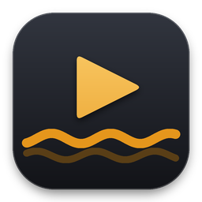

# Castaway



**A free, self-hosted media server and player for your own movies and shows, in the spirit of Plex and Jellyfin.**
Made by Bytehawk Studio.

Run Castaway Server on your own PC, NAS or home server (on its own or in Docker), point it at your movie and TV
folders, and watch your library from anywhere: at home or away. No subscriptions, no paid tiers.

> **Status: early preview (v0.1.0), Windows only.** This is the player app's shell: the window, sidebar,
> light and dark mode and settings work, Home shows the planned layout with made-up sample titles, and every
> other section is a "coming soon" page describing what it will do. There is no server yet, so nothing plays.

## What's in the preview

| Section | Status |
| --- | --- |
| **Home** | Preview with sample titles: Continue Watching, Recently Added Movies and Recently Added TV. |
| Movies | Coming soon |
| TV Shows | Coming soon |
| Kids & Family | Coming soon |
| Documentaries | Coming soon |
| Stand-Up | Coming soon |
| Anime | Coming soon |
| Castaway Server | Coming soon (the server that holds and streams your media, Docker-ready) |
| Remote Access | Coming soon (watch away from home over Tailscale, Cloudflare Tunnel or port forwarding) |
| Activity | Coming soon (who's watching what, right now) |
| Appearance | Works: light / dark mode from the sidebar, or Settings → Appearance → "Match Windows". |

Each coming-soon page lists its planned features. They are defined in
[`Models/ModuleCatalog.cs`](src/Castaway.Desktop/Models/ModuleCatalog.cs).

## Download

Windows 10/11 (x64). Install it from the **[Bytehawk Studio Launcher](https://github.com/adamglassner/bytehawklauncher)**,
which downloads the newest release, installs it and keeps it up to date. Or get it from the
[latest release](../../releases/latest):

- **`Castaway-<version>-Setup.exe`**: installer with Start Menu shortcut, optional desktop shortcut and an
  uninstaller. Installs just for you by default (no administrator prompt).
- **`Castaway-<version>-win-x64.zip`**: portable. Unzip anywhere and run `Castaway.exe`.

Neither needs .NET installed. Settings are saved in `%AppData%\Castaway\`.

## Releasing a new version

Change `<Version>` in `src/Castaway.Desktop/Castaway.Desktop.csproj` (for example to `0.1.1`), add a
[CHANGELOG](CHANGELOG.md) entry and push to `main`. GitHub Actions ([build-release.yml](.github/workflows/build-release.yml))
then, on a Windows machine:

1. builds the single-file exe, the portable zip and the installer,
2. runs the self-test (`Castaway.exe --self-test result.txt`): every page in light and dark, plus navigation checks,
3. silently installs the Setup .exe to a custom folder (the way the launcher does), starts it, and uninstalls it,
4. takes light/dark screenshots (attached to the run as artifacts),
5. publishes GitHub Release `v<version>` with the Setup .exe and the zip.

Installed copies pick up the new version through the Bytehawk Studio Launcher. Pushes that don't change the
version, and pull requests, run steps 1 to 4 only.

## Building it yourself

Requirements: Windows 10/11, the [.NET 8 SDK](https://dotnet.microsoft.com/download/dotnet/8.0), and
[Inno Setup 6](https://jrsoftware.org/isinfo.php) for the installer (`winget install JRSoftware.InnoSetup`).

- Run from source: double-click `run.bat`, run `dotnet run --project src\Castaway.Desktop`, or open `Castaway.sln`
  in Visual Studio 2022 and press F5.
- Build everything: `.\build.ps1` makes `dist\Castaway.exe`, `dist\Castaway-<version>-win-x64.zip` and
  `dist\Castaway-<version>-Setup.exe`. Use `-SkipInstaller` to skip Inno Setup.

Command-line options: `--page <section>` opens a page at startup (for example `--page movies` or `--page settings`),
and `--self-test <file>` runs the checks above and exits with the number of failures.

## Project layout

```
src/Castaway.Desktop/
  App.xaml(.cs)          app startup + light/dark theme switching
  MainWindow.xaml(.cs)   sidebar, top bar, page host, status bar, toast
  Assets/                app icon (.ico + .png)
  Themes/                Light.xaml, Dark.xaml (colors), Controls.xaml (styles)
  Models/                ModuleCatalog.cs — every section, its planned features
  Views/                 HomeView (sample-title preview), ComingSoonView, SettingsView
  Services/              settings, Windows theme detection, toast helper, self-test
installer/Castaway.iss   Inno Setup script (+ wizard images)
build.ps1                exe + portable zip + installer
.github/workflows/       CI: build, self-test, installer test, screenshots, release
design/                  the library view mockup this is built from
tools/make_icon.py       regenerates the icon (Python + Pillow)
tools/make_wizard_images.py  regenerates the installer wizard images
```

To add a coming-soon section, add an entry to `Models/ModuleCatalog.cs`.
To build a section for real, give it its own view in `Views/`, set `IsComingSoon = false` and show that view
from `MainWindow.Show`.

## Design

The look comes from the library view mockup in [`design/library-mockup.html`](design/library-mockup.html)
(open it in any browser).

## Roadmap

1. Castaway Server: scan movie and TV folders, match posters and details, stream to the app (runs on its own or in Docker)
2. Movies and TV Shows libraries in the app, with playback and Continue Watching
3. Kids & Family, Documentaries, Stand-Up and Anime libraries, and profiles
4. Remote access and on-the-fly video conversion (FFmpeg)
5. Players for other devices

## License

MIT — see [LICENSE](LICENSE). © 2026 Bytehawk Studio.
